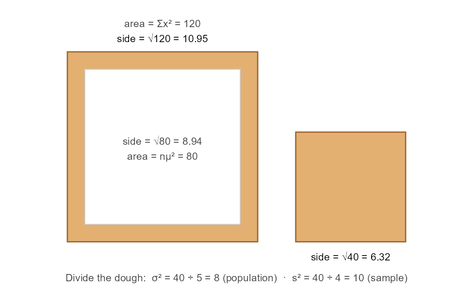
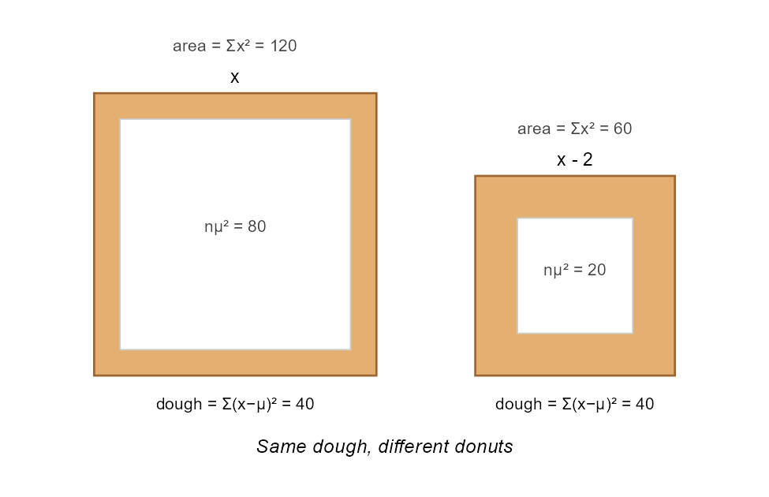

# variancedonuts

Square-donut pictures of the variance.

The identity

    sum(x^2) = n * mean^2 + sum((x - mean)^2)

can be drawn as a square donut. The whole donut is the sum of squared values,
the hole comes from the mean, and the dough is the sum of squared deviations.
Dividing the dough by `n` gives the population variance, and dividing it by
`n - 1` gives the sample variance.



## Installation

The package is not on CRAN yet. Install it from GitHub:

``` r
# install.packages("pak")
pak::pak("ghahnghahn/variancedonuts")
```

## Example

``` r
library(variancedonuts)

x <- c(1, 2, 3, 5, 9)
donut_stats(x)
#> Square donut, sum scale, n = 5
#>   whole = hole + dough:  120 = 80 + 40
#>   population variance:   40 / 5 = 8
#>   sample variance:       40 / 4 = 10

donut_frame(x)                                   # one donut
donut_compare(x, x - 2, labels = c("x", "x - 2")) # two donuts, one scale
```

Shifting the data changes the hole but not the dough, so the variance is
unchanged:



## What else is in the package

* `scale = "mean"` draws the per-observation donut, where the dough is the
  variance itself and the Berliner's side is the standard deviation.
* `donut_compare()` keeps both donuts on one scale, warns when the data sets
  have different sizes, and notes when one donut is too small to see.
* `donut_stats()` flags glaze-thin data, where the shortcut formula
  `sum(x^2) - n * mean^2` can lose accuracy. The package itself never uses
  that formula.
* `donut_schemes()` lists ten color schemes: plain golden (the default),
  light, four with a stripe of pink or white glaze, sprinkles (`color = 7`),
  and three flavors: strawberry, chocolate and vanilla.
* `donut_examples` holds the data sets from the paper.

## Saving pictures

The labels use Greek letters, which R's basic `pdf()` device cannot draw. Use
`ggplot2::ggsave("donut.pdf", p, device = cairo_pdf)`, or save as PNG.

## Citation

Hahn, E. D. Oh doughnuts, it's the variance! A visual metaphor for the
variance, standard deviation, and related quantities. Preprint, arXiv.
